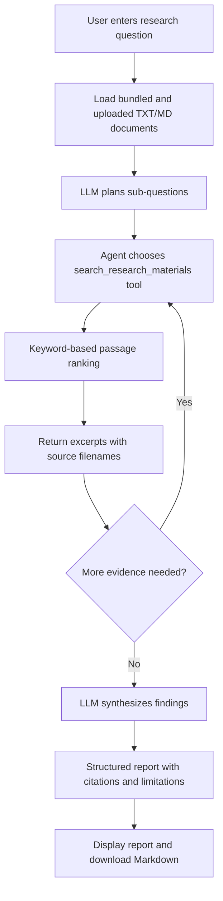

# ResearchPilot workflow schema

## Flowchart



## JSON workflow schema

```json
{
  "project": "ResearchPilot",
  "version": "1.0",
  "type": "agentic_research_assistant",
  "input": {
    "research_question": "string",
    "reference_documents": ["txt", "md"]
  },
  "components": [
    {
      "id": "document_loader",
      "type": "data_ingestion",
      "output": "documents"
    },
    {
      "id": "research_agent",
      "type": "llm_agent",
      "framework": "LangChain/LangGraph",
      "responsibilities": [
        "decompose_question",
        "select_search_queries",
        "decide_whether_more_evidence_is_needed",
        "synthesize_report"
      ]
    },
    {
      "id": "search_research_materials",
      "type": "tool",
      "input": "query",
      "operation": "keyword_overlap_passage_ranking",
      "output": "ranked_passages_with_source_filenames"
    },
    {
      "id": "report_generator",
      "type": "llm_synthesis",
      "output_sections": [
        "Research question",
        "Research plan",
        "Executive summary",
        "Key findings",
        "Limitations and evidence gaps",
        "Further research questions"
      ]
    }
  ],
  "control_flow": [
    "document_loader -> research_agent",
    "research_agent -> search_research_materials",
    "search_research_materials -> research_agent",
    "research_agent -> report_generator",
    "report_generator -> user"
  ],
  "guardrails": [
    "Cite retrieved source filenames",
    "Do not invent references",
    "Report evidence gaps",
    "Warn user to verify generated claims"
  ]
}
```

## How to explain the agentic behaviour

1. The model decomposes a broad question into smaller research questions.
2. The model selects and invokes a search tool rather than only generating an answer immediately.
3. Tool results return to the model, which can request further searches.
4. The model synthesizes the retrieved excerpts into a report and labels evidence gaps.

The graph/tool orchestration is provided by the LangChain/LangGraph framework. The project-specific retrieval function, research instructions, source formatting, user interface and report download are application-level implementation choices.
